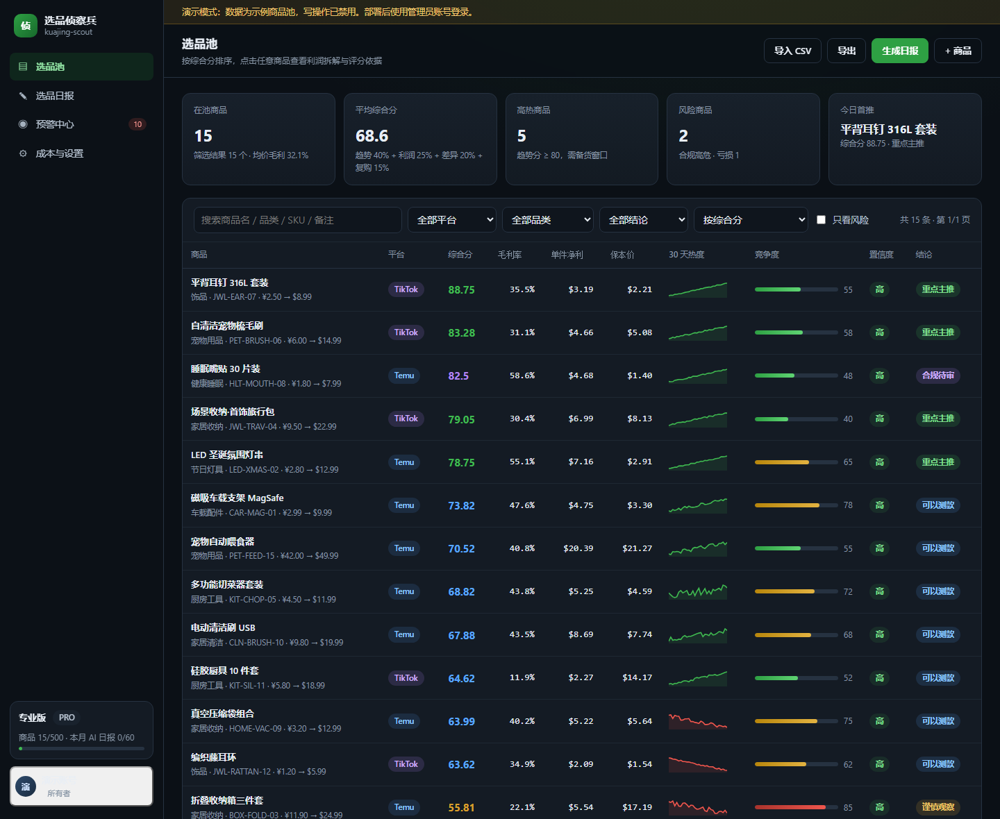
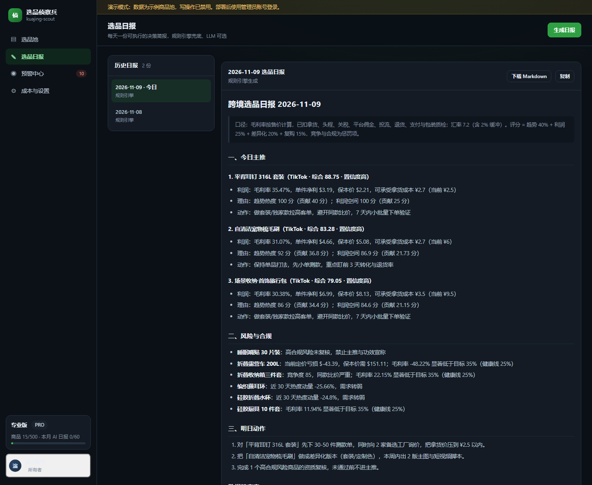
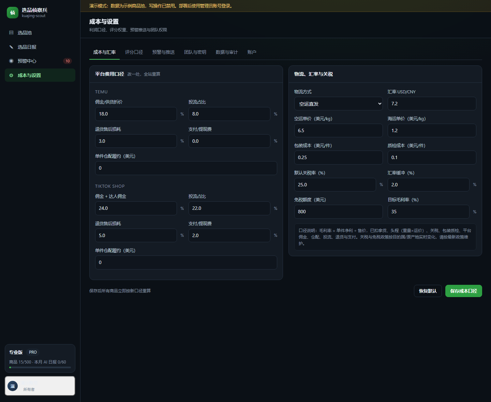
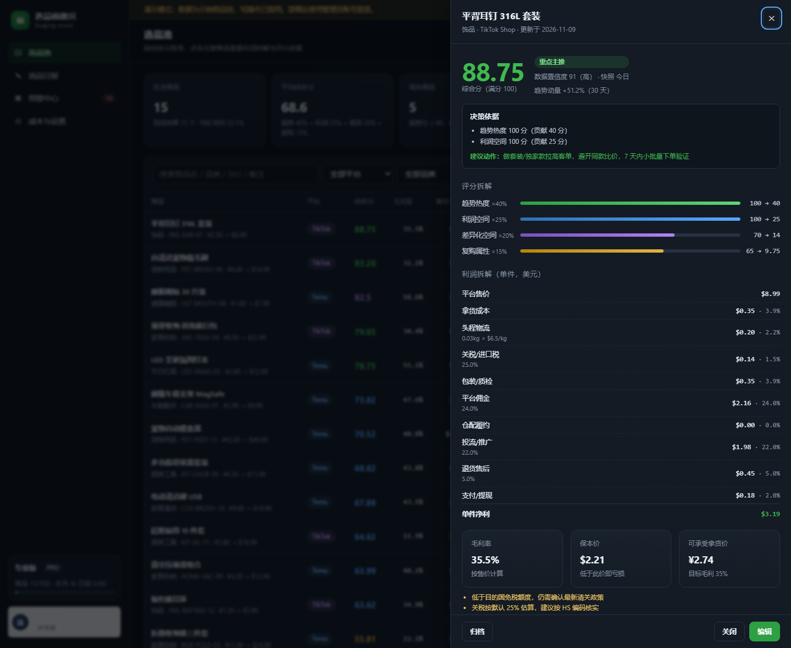

# 跨境选品侦察兵 · kuajing-scout

**把选品从「拍脑袋」变成「可复算的决策」**：利润瀑布 → 可解释评分 → 可执行日报 → 风险预警。

零 npm 依赖，`git clone` 即可运行；面向跨境卖家的**私有化部署 / 小团队 SaaS**。



## 为什么不是又一个「数据大盘」

市面上的选品工具（卖家精灵、Jungle Scout、Kalodata、FastMoss 等）核心壁垒是**数据**：海量商品库、销量估算、关键词与达人数据。
本项目不重复造数据层，而是补上它们普遍薄弱的一层——**决策层**：

| 能力 | 常见工具 | kuajing-scout |
| --- | --- | --- |
| 数据来源 | 自建采集 / 第三方授权 | 卖家自有数据：手动、CSV、外部推送 API、Google Trends 信号 |
| 利润 | 计费器（需自己填费率） | 成本瀑布：拿货/头程/关税/佣金/投流/退货/支付/包装质检，反推保本价与可承受成本 |
| 评分 | 榜单/销量排序 | 趋势 40% + 利润 25% + 差异化 20% + 复购 15%，扣分项与置信度全部可见 |
| 日报 | 数据报表 | 主推 + 风险 + 明日动作，规则引擎兜底，LLM 可选且失败自动降级 |
| 合规 | 少见 | 高合规风险商品在复核前锁定「待审」，禁止主推 |

## 核心能力

- **利润引擎 v2**：按重量×运价算头程，显式计入关税、投流、退货、支付、包装质检与汇率缓冲；毛利率按售价计算，不再虚高。
- **2026 关税与履约口径**：默认免税额度为 0（美国 2025/8 取消 800 美元低值免税，欧盟 2026/7 取消 150 欧免税并改按商品项征 €3 固定关税）。支持「每件固定关税 / 每票固定报关费」——这类成本与货值无关，单列后才不会系统性高估低客单价商品的净利；支持切换 `direct`（直发 / 全托管供货）与 `local`（半托管 / 海外仓本地发货，含入库分摊、仓储、尾程、滞销损耗四项）。固定税费与本地履约成本同步纳入保本价和可承受拿货价的反解。
- **可解释评分**：每个商品输出四因子贡献、惩罚项、30 天动量、数据置信度与建议动作；权重与阈值按租户可调。
- **选品日报**：每日定时生成并落库，LLM 支持重试/超时/token 成本记账/Prompt 注入防护，无 Key 或超配额时自动降级规则报告。
- **风险预警**：亏损定价、合规高危、竞争红海、热度下滑自动汇总，支持企业微信/飞书/Slack/Server酱推送，按天去重。
- **多租户与权限**：owner / admin / analyst / viewer 四级角色，服务端会话 + CSRF + API Key，全量操作审计。
- **商用配套**：套餐配额（商品数/席位/AI 日报/导出）、用量与 LLM 成本记账、数据导入导出、健康检查、优雅退出、Docker。

| 选品日报 | 成本口径 |
| --- | --- |
|  |  |

每个商品都能展开到「决策依据 → 评分拆解 → 利润瀑布 → 保本价 → 数据缺口」：



## 快速开始

环境：**Node.js ≥ 22.5**（推荐 24 LTS）。**无需 npm install**。

```bash
# 1) 配置
cp .env.example .env
node -e "console.log(require('crypto').randomBytes(32).toString('hex'))"   # 写入 SESSION_SECRET

# 2) 创建管理员（或设置 BOOTSTRAP_ADMIN_EMAIL / PASSWORD 后首次启动自动创建）
npm run create-user -- --email you@example.com --password "REPLACE_WITH_A_STRONG_PASSWORD"

# 3) 启动
npm start            # http://127.0.0.1:3600/
```

首次启动会自动建表、跑迁移；开发环境会写入 15 个演示商品 + 30 天快照 + 示例日报。
正式使用前把 `IMPORT_ON_BOOT` 设为 `0`（并建议删除 `data/scout.db` 重新初始化），再用 CSV 或 API 导入自己的商品池。

### 演示模式

```bash
DEMO_MODE=1 npm start
```

首页自动以只读演示账号进入，适合做在线 Demo；所有写操作会被拒绝。

### 接入 LLM（可选）

```bash
LLM_API_KEY=sk-xxx
LLM_BASE_URL=https://api.deepseek.com/v1   # 任何 OpenAI 兼容接口
LLM_MODEL=deepseek-chat
```

未配置时日报由规则引擎生成，结论与数字同样来自利润/评分引擎，不会降级成空模板。

## 目录结构

```
server/
  app.js            HTTP 应用：路由/鉴权/CSRF/限流/静态资源/错误处理
  index.js          启动：迁移 → 初始化 → 路由 → 定时任务 → 优雅退出
  config.js         .env 加载 + 生产环境强校验
  migrations.js     版本化迁移（自动升级 v0.1 单租户库）
  seed.js           演示数据
  lib/              校验、加密、CSV、时区、日志、限流、HTTP
  services/         利润、评分、商品、快照、日报、预警、通知、套餐、数据源
  api/              auth / products / reports / alerts / settings / ops
public/             无构建前端（原生 JS + CSS，严格 CSP）
test/               node:test 单元与接口测试（66 个用例）
docs/               API、部署、合规模板
```

## 安全设计

- 密码 **scrypt** 散列（含盐、常量时间比较），登录失败统一文案，弱口令拦截
- 服务端会话（可撤销）+ HttpOnly/SameSite Cookie + 双提交 CSRF + 同源校验
- API Key 仅存 SHA-256 摘要，支持只读/读写作用域与撤销
- 四层限流（登录/写操作/导出/推送），请求体限长，安全响应头与严格 CSP
- 静态资源路径包含校验（防目录穿越），SQL 全部参数化，输出统一转义
- Webhook 出站做协议与内网地址校验（防 SSRF）
- 审计日志记录操作者、对象、IP 与时间

## 测试

```bash
npm test
```

覆盖：利润公式与保本价反解、评分因子/惩罚/合规门禁、CSV 与公式注入、输入校验、认证与权限、
API 全链路（CSRF、租户隔离、配额 402、路径穿越）、旧库迁移、Markdown XSS。

## 部署

Docker：

```bash
docker build -t kuajing-scout .
docker run -d --name scout -p 3600:3600 \
  -e SESSION_SECRET="$(openssl rand -hex 32)" \
  -e BOOTSTRAP_ADMIN_EMAIL=you@example.com \
  -e BOOTSTRAP_ADMIN_PASSWORD='REPLACE_WITH_A_STRONG_PASSWORD' \
  -v scout-data:/app/data kuajing-scout
```

示例中的密码仅为占位符，部署时必须替换为你自己生成的强密码（例如 `openssl rand -base64 24`），切勿沿用文档里的任何字符串。

Nginx、systemd、备份恢复、监控与升级步骤见 [docs/DEPLOY.md](docs/DEPLOY.md)。

## 文档

- [API 参考](docs/API.md)
- [部署运维](docs/DEPLOY.md)
- [服务条款（模板）](docs/legal/服务条款.md) / [隐私政策（模板）](docs/legal/隐私政策.md)

## 路线图

- [x] 多租户、认证授权、审计、配额与用量
- [x] 利润引擎 v2、可解释评分 v2、预警、Webhook
- [x] CSV 导入导出、外部数据推送 API
- [ ] 官方数据源/授权数据接入（Amazon SP-API、TikTok Shop Partner、Keepa 等）
- [ ] 支付与订阅（Stripe / 支付宝）、发票
- [ ] 多实例部署（Postgres + Redis 限流/任务队列）
- [ ] 移动端 PWA、英文界面、团队协作评论

## 免责声明

选品评分与日报是基于公开参数与用户输入的计算结果，**不构成投资或经营建议**。
关税、平台费率、免税额度与合规要求会变化，请以官方最新政策为准；数据采集与使用需自行确保合法授权。

MIT © 2026 heySu
