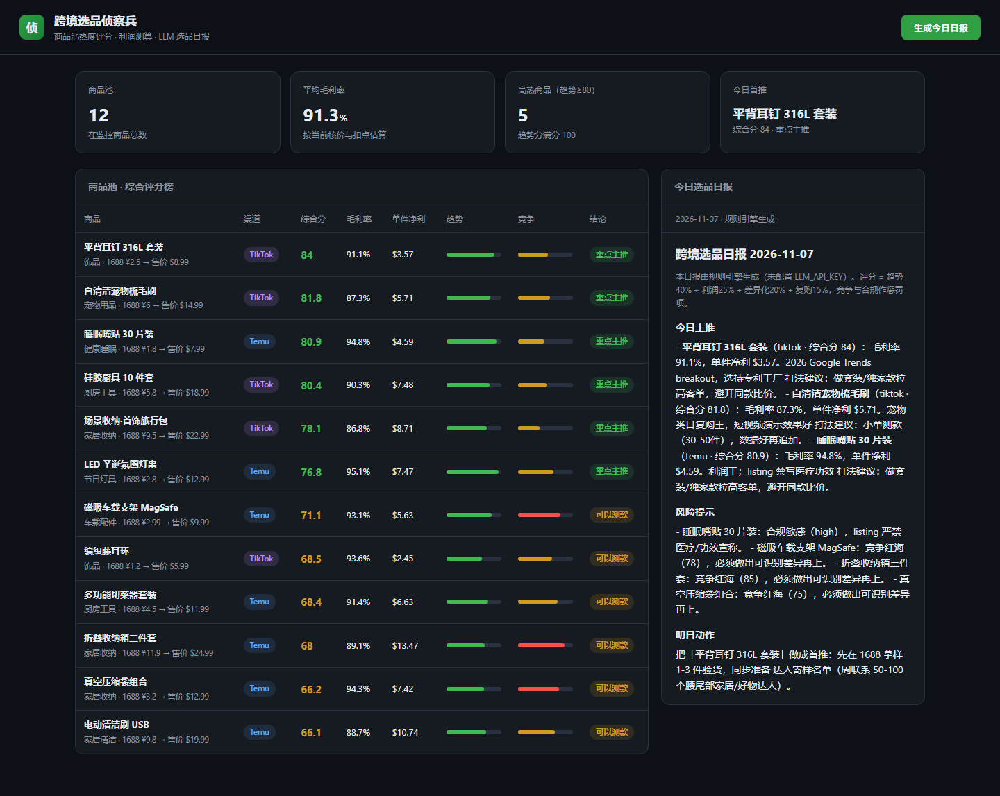

# 跨境选品侦察兵 · kuajing-scout

跨境卖家的**选品监控 Agent**：商品池综合评分 → 利润测算 → 每日选品日报（LLM 撰写，无 Key 自动降级规则引擎）。

评分维度与权重量化了真实选品逻辑：**趋势 40% + 利润 25% + 差异化 20% + 复购 15%**，竞争红海与合规风险作为惩罚项。核价/扣点/汇率全部集中可配（`server/db.js` 的 `CONFIG`）。



## 快速开始

环境要求：**Node.js 22+**（内置 `node:sqlite`，零 npm 依赖，无需 `npm install`）。

```bash
node --experimental-sqlite --no-warnings server/index.js
# 打开 http://127.0.0.1:3600/
```

商品池内置 12 个 2026 年实测调研商品（Temu 美国站 + TikTok 趋势），首次启动自动建表 + 回填 7 天趋势快照。

## 启用 LLM 日报（可选）

兼容一切 OpenAI 兼容接口（OpenAI / DeepSeek / 通义 / 本地 Ollama 等）：

```bash
# Windows PowerShell
$env:LLM_API_KEY="sk-xxx"          # 必填
$env:LLM_BASE_URL="https://api.deepseek.com/v1"   # 可选，默认 OpenAI
$env:LLM_MODEL="deepseek-chat"     # 可选，默认 gpt-4o-mini
npm start
```

未配置时日报由**规则引擎**生成（模板化结论，依然可用），配置后由 LLM 按「选品顾问」人设撰写：主推分析 + 风险提示 + 明日动作。

## 功能一览

| 模块 | 说明 |
| --- | --- |
| 综合评分榜 | 趋势/竞争双向进度条，毛利率、单件净利实时测算，三档结论（主推/测款/观望） |
| 利润引擎 | 汇率、Temu 18% / TikTok 24% 扣点、头程占比集中配置，改一处全站生效 |
| 选品日报 | 一键生成，自动落库 + 写入 `reports/daily-YYYY-MM-DD.md`，按天幂等（重生成即覆盖） |
| 趋势快照 | 每 6 小时自动记录热度，为后续趋势回归分析积累数据 |
| 编辑接口 | `PATCH /api/products/:id` 可改商品参数，评分即时重算（为接爬虫数据源预留） |

## API

```
GET  /api/products          # 全量商品 + 评分明细
GET  /api/top?n=3           # 综合分前 N
GET  /api/trend?id=1        # 单品 7 天热度序列
GET  /api/reports           # 日报列表
GET  /api/reports/:day      # 某天日报全文
POST /api/report/generate   # 立即生成今日日报（快照+评分+落库）
PATCH /api/products/:id     # 更新商品参数
```

## 设计取舍

- **零依赖**与 [youchou](https://github.com/heySu/youchou) 同一技术签名：`node:http` 手写路由、`node:sqlite` WAL 模式，克隆即跑，不受 npm 源与原生编译问题影响
- **Agent 分层**：数据层（db）→ 评分引擎（纯函数，可单测）→ LLM 编排（可插拔、失败降级）→ HTTP/UI，每层职责单一
- 数据源当前为种子商品池 + 手动/定时快照；爬虫接入点已预留（`PATCH` 接口 + `snapshots` 表）

## 路线图

- [ ] 接入公开趋势数据源（Google Trends RSS 等）自动更新 `trend_score`
- [ ] 日报定时推送（Server酱 / 企业微信 webhook）
- [ ] 多用户 + 商品池自定义管理

---

MIT © 2026 heySu
